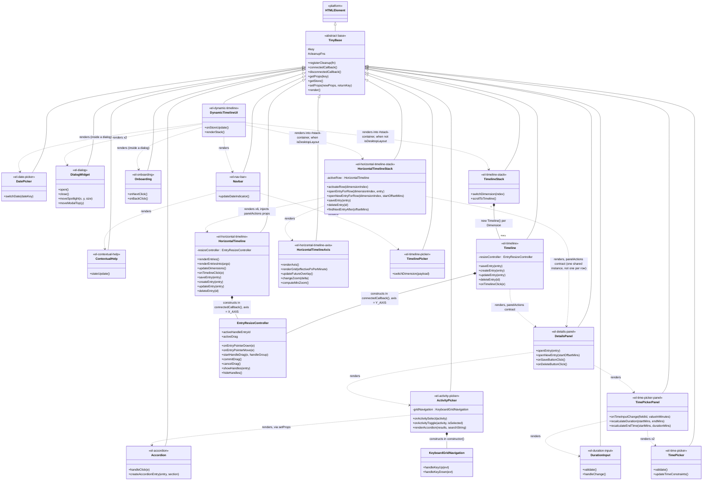

# Class Diagram

[← Back to root README](../../README.md) · [← Back to Components](README.md)

---

Every class in `src/`. All Web Components extend [`TinyBase`](README.md#basejs) (itself extending the platform's `HTMLElement`); two plain helper classes — [`KeyboardGridNavigation`](activityPicker/README.md) and [`EntryResizeController`](timeline/README.md) — are not custom elements, just state machines constructed and owned by the component that needs them. `src/store/` and `src/utils/` are deliberately function/module-based, not classes (see the [store README](../store/README.md)) — the hand-rolled Redux clone in `store.js` and the props-passing registry in `propsRegistry.js` are the main reasons `TinyBase` can stay so small.

## Reading this diagram

- **`<|--` (inheritance)** — every Web Component genuinely `extends TinyBase extends HTMLElement`. This is the only relationship type that's a real JS prototype chain.
- **`*--` (composition)** — the owning class builds the other with `new X(...)` and holds a direct reference to it (`this.gridNavigation`, `this.resizeController`, or the N `Timeline` instances `TimelineStack.render()` creates in a loop). A real object relationship, not just markup.
- **`..>` (dependency)** — one component's `render()` emits another's custom-element tag as a string (e.g. `<el-activity-picker>`), optionally handing it data/callbacks through the [props registry](README.md#propsregistryjs) (`setProps`/`key`/`getProps`). There's no direct class reference here — the two components are coupled only through the tag name and whatever contract they agree on through props (see [DetailsPanel's `panelActions` contract](detailsPanel/README.md#the-panelactions-contract) for the clearest example of this deliberately loose coupling).

## What's deliberately left out

- **Test-only harness classes** — several `*.test.js` files declare a small local `class TestHarness extends TinyBase {}` (or `RegisterCleanupHarness`) purely so a test can call `setProps` on a component's behalf (see the test-naming note in the root [CLAUDE.md](../../CLAUDE.md), and `base.test.js`, `detailsPanel.test.js`, `dialogWidget.test.js`, `onboarding.test.js`, `timePicker.test.js`, `timePickerPanel.test.js`). These are test infrastructure, not part of the production architecture, so they're omitted here.
- **`src/store/`, `src/utils/`, `scripts/generate_no_js.js`** — none of these define a class; they're plain functions/modules. See the [store README](../store/README.md) for how state is actually shaped.

---

[← Back to root README](../../README.md) · [← Back to Components](README.md)
